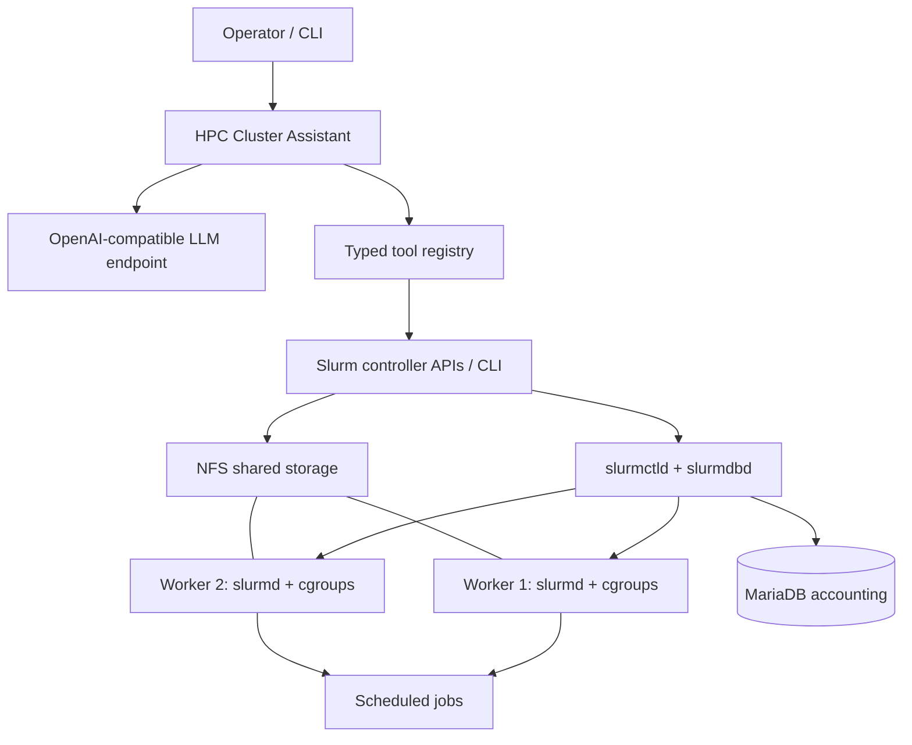

# Slurm HPC Cluster Lab

<p align="center">
  
</p>

<p align="center">
  <strong>Build. Schedule. Observe. Automate.</strong><br>
  A reproducible two-worker HPC lab using Slurm, NFS, Linux cgroups, preemption, accounting, multi-node jobs, and a guarded LLM cluster assistant.
</p>

<p align="center">
  <a href="https://github.com/shayan878/slurm-hpc-cluster-lab/actions/workflows/ci.yml"></a>
  
  
  
  
  
</p>

> **What this is:** a hands-on engineering lab based on the supplied HPC internship notes. It documents the cluster setup and turns the original scripts into reusable, testable examples.
>
> **What this is not:** a production-ready cluster distribution or a claim that the original lab has been independently reproduced on fresh hardware. Hardware-specific values, service versions, and cluster policies must be validated in your environment.

## Why this project is interesting

A small HPC cluster is more than a collection of SSH hosts. It needs shared files, consistent identities, a scheduler, resource isolation, accounting, observability, and safe operational controls. This project brings those pieces together and adds an LLM interface that can inspect Slurm state while requiring explicit human approval for administrative changes.

### Project highlights

| Area | What is included |
|---|---|
| **Cluster architecture** | Controller + worker nodes, shared storage, service boundaries, and a deployment checklist |
| **NFS** | Restricted export example, client mount instructions, identity and permission considerations |
| **Slurm** | `slurm.conf`, controller/worker setup, partitions, job submission and monitoring |
| **Resource isolation** | cgroup v2-oriented configuration, CPU/RAM/swap constraints, and safe validation notes |
| **Scheduling policy** | Priority tiers and requeue-based preemption example |
| **Accounting** | MariaDB/SlurmDBD configuration templates and `sacct` workflows |
| **Distributed workloads** | Modular prime-number workload split across Slurm task ranks |
| **Python engineering** | Typed configuration, HTTP client, tool registry, command adapter, CLI and unit tests |
| **LLM cluster assistant** | Read-only status tools by default; allow-listed nodes and explicit approval for drain/resume |

## Architecture



The Python assistant intentionally does **not** expose arbitrary shell execution to the model. The tool surface is a small set of typed Slurm operations. Mutating operations are hidden unless explicitly enabled, restricted to configured node names, and require an interactive operator confirmation.

## Repository map

```text
slurm-hpc-cluster-lab/
├── .github/                 # CI, issue forms, pull-request template
├── assets/                  # Architecture artwork for the README
├── configs/
│   ├── nfs/                  # Safe NFS export and client mount examples
│   ├── slurm/                # slurm.conf, cgroup.conf, slurmdbd templates
│   └── assistant/            # Environment-variable example; no credentials
├── docs/
│   ├── architecture/         # Cluster design and network assumptions
│   ├── deployment/           # Controller, worker, NFS, Slurm and identity setup
│   ├── operations/           # cgroups, preemption, accounting and monitoring
│   ├── assistant/            # LLM assistant design and safety model
│   ├── experiments/          # What the internship notes reported
│   └── security/             # Secrets, NFS and administrative safety
├── jobs/slurm/               # Single-node, multi-node and scheduler examples
├── scripts/                  # Health checks and configuration validation
├── src/hpc_cluster_lab/      # Modular Python package
│   ├── assistant/            # Config, API client, bot, CLI and tool registry
│   ├── slurm/                # Safe subprocess adapter for fixed Slurm commands
│   └── workloads/            # Distributed prime-number example
└── tests/                    # Unit tests without a live Slurm cluster
```

## Quick start

### 1. Understand the target environment

The examples assume one Slurm controller and two Linux workers. Replace every hostname, network, CPU count, RAM value, partition name, and path with values from your own hosts. On each compute node, inspect the real hardware with:

```bash
sudo slurmd -C
hostname -f
ip -br address
```

Do not copy the example node resources into a real `slurm.conf` without checking them against the actual worker configuration.

### 2. Set up shared storage

Read [NFS deployment](docs/deployment/nfs.md), then adapt:

- [`configs/nfs/exports.example`](configs/nfs/exports.example)
- [`configs/nfs/fstab.example`](configs/nfs/fstab.example)

The export example uses `root_squash` and a documentation-only subnet. Replace the subnet with the smallest trusted cluster network. Avoid `no_root_squash` and world-writable shared folders unless you have a documented, reviewed reason. See the [security notes](docs/security/nfs-and-identities.md).

Read [`docs/deployment/users-and-groups.md`](docs/deployment/users-and-groups.md) before enabling multi-user shared storage.

### 3. Configure Slurm

Start with:

- [`configs/slurm/slurm.conf.example`](configs/slurm/slurm.conf.example)
- [`configs/slurm/cgroup.conf.example`](configs/slurm/cgroup.conf.example)
- [`docs/deployment/slurm-controller-and-workers.md`](docs/deployment/slurm-controller-and-workers.md)

The cgroup template is oriented toward modern cgroup v2 systems. Slurm's cgroup v1 plugin is deprecated; confirm your distribution, systemd mode, Slurm release and kernel before enabling enforcement. The official Slurm guide recommends `CgroupPlugin=autodetect` as a general choice for supported systems. [Reference](https://slurm.schedmd.com/cgroup_v2.html).

### 4. Submit a test job

After the cluster is configured and `sinfo` reports the expected nodes, submit a single-worker job:

```bash
sbatch jobs/slurm/prime-single.sbatch
```

Then run the two-task distributed example:

```bash
sbatch jobs/slurm/prime-distributed.sbatch
```

The Python workload derives a disjoint range from `SLURM_PROCID` and `SLURM_NTASKS`; it does not rely on an unexported Bash array inside a child shell. Ensure the package is installed in the job environment on every worker (or available from a shared virtual environment) before submission; see [`jobs/slurm/README.md`](jobs/slurm/README.md).

### 5. Run the Python checks locally

Requires Python 3.10+.

```bash
python -m venv .venv
source .venv/bin/activate
python -m pip install -e '.[dev]'
ruff check .
pytest -q
```

The tests use fake command runners and mocked HTTP responses. They do not require Slurm, NFS, MariaDB or an LLM endpoint.

### 6. Run the optional LLM assistant

Copy the environment template and configure an OpenAI-compatible endpoint using environment variables:

```bash
cp configs/assistant/.env.example .env
# Edit .env locally. Never commit it.
set -a
source .env
set +a
hpc-cluster-assistant
```

Required variables: `LLM_BASE_URL` and `LLM_MODEL`. `LLM_API_KEY` is optional for endpoints that do not require authentication. Set `SLURM_ALLOWED_NODES=worker1,worker2` to permit the assistant to target those node names for administrative actions.

By default, the assistant is read-only. To expose drain/resume tools, start it with:

```bash
hpc-cluster-assistant --enable-admin-actions
```

Each drain/resume call still requires the operator to type `yes` at the terminal, and node names must match the configured allow-list. Do not run this assistant with an account that has more Slurm privileges than it needs.

## What the internship notes covered

The original source describes the following progression:

1. **Cluster foundation:** NFS server/client setup, Slurm installation, controller/worker configuration, and a single-node prime-number job.
2. **Distributed execution:** split a numerical workload across two Slurm tasks and inspect the output from each task.
3. **Resource management:** cgroup CPU/RAM/swap controls, `batch` and `urgent` partitions, and preemption experiments.
4. **Accounting and operations:** MariaDB + SlurmDBD, user identity alignment, multiple-user job submission, node drain/resume, `sinfo`, `squeue` and `sacct`.
5. **LLM operations assistant:** function calling for cluster status, active jobs, node maintenance and command execution. This repository preserves the useful operator workflows but deliberately removes arbitrary command execution from the model-facing interface.

A source-grounded summary and limitations are in [Internship experiment notes](docs/experiments/internship-observations.md).

## Important safety and reproducibility notes

- **Credentials:** the supplied source contained a hard-coded API credential and a database password. Neither is included here. Treat exposed credentials as compromised and rotate/revoke them before publishing.
- **Infrastructure details:** private IP addresses, internal hostnames and the original service domain were replaced with placeholders.
- **NFS:** exports are limited to a trusted subnet and use root squashing by default. NFS permissions depend on UID/GID consistency across nodes.
- **Slurm:** configuration syntax and plugins vary by release and distribution. Validate templates against your installed Slurm version before restarting services.
- **Cgroups:** modern systems generally use cgroup v2. Do not copy the internship's legacy GRUB workaround without checking the current kernel/systemd/Slurm requirements.
- **Preemption:** with `PreemptMode=REQUEUE`, jobs need `--requeue` or the cluster-wide `JobRequeue=1` setting to be requeued. Understand the effect on checkpoints and job data before enabling it.
- **LLM safety:** language-model tool calls are untrusted input. Only fixed, typed operations are implemented; never wire model output directly into `shell=True` or an unrestricted remote shell.
- **License:** the original internship record lists multiple participants. This repository intentionally does not grant a blanket open-source license until the rights to publish and license the collaborative material are confirmed. See [`LICENSE_STATUS.md`](LICENSE_STATUS.md).

## Roadmap

- [ ] Validate the templates on a clean controller + two-worker VM environment.
- [ ] Add a reproducible deployment using Ansible after the target OS/Slurm release is selected.
- [ ] Capture redacted `sinfo`, `squeue`, `sacct` and job outputs as example fixtures.
- [ ] Add job-efficiency and memory-accounting reports from real `sacct` data.
- [ ] Add additional safe tools: partition summaries, accounting queries and read-only node diagnostics.
- [ ] Add screenshots or a short terminal demo from a real lab run.

## References

- [Slurm documentation](https://slurm.schedmd.com/documentation.html)
- [Slurm `slurm.conf`](https://slurm.schedmd.com/slurm.conf.html)
- [Slurm cgroup guide](https://slurm.schedmd.com/cgroups.html)
- [Slurm cgroup v2 notes](https://slurm.schedmd.com/cgroup_v2.html)
- [Slurm preemption](https://slurm.schedmd.com/preempt.html)
- [Slurm `slurmdbd.conf`](https://slurm.schedmd.com/slurmdbd.conf.html)
- [Ubuntu NFS server guide](https://ubuntu.com/server/docs/how-to/networking/install-nfs/)
- [Linux `exports(5)`](https://man7.org/linux/man-pages/man5/exports.5.html)

## Publishing

See [`PUBLISHING.md`](PUBLISHING.md) for suggested repository metadata, topics, and exact push commands.

## Acknowledgements

The supplied internship record lists Shayan Daneshyar, Ahmadreza Anami, Bagher Hosseini and Mohammadhesam Imanirad as participants. Confirm the appropriate attribution and publication permissions with all relevant rights holders before making the repository public or adding an open-source license.
