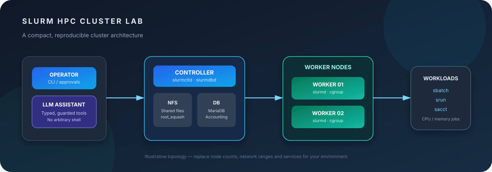
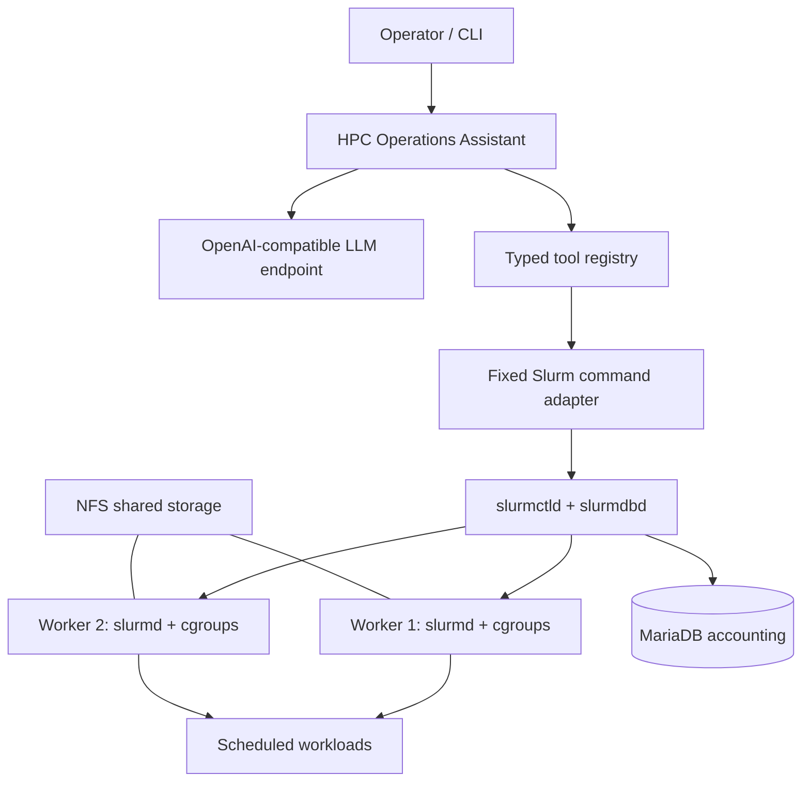

# Intelligent HPC Operations

<p align="center">
  
</p>

<p align="center">
  <strong>Operate. Schedule. Observe. Automate.</strong><br>
  A modular HPC operations toolkit built around Slurm, NFS, Linux cgroups, workload scheduling, accounting, distributed jobs and guarded LLM-assisted administration.
</p>

<p align="center">
  <a href="https://github.com/shayan878/intelligent-hpc-operations/actions/workflows/ci.yml"></a>
  
  
  
  
  
</p>

> **Project scope:** reusable configuration examples, operational documentation, distributed workload examples and a Python package for guarded Slurm administration. This is an engineering portfolio project—not a production-ready cluster distribution or a claim of fresh hardware validation.

## Overview

A useful HPC environment needs more than compute nodes. It needs consistent identities, shared storage, a scheduler, resource enforcement, accounting, monitoring and safe operational workflows.

This project brings those components together for a small controller/worker cluster and includes an optional LLM assistant that can inspect live Slurm state. Administrative actions are deliberately constrained: the assistant exposes no arbitrary shell tool, requires an explicit opt-in for administrative tools, checks a configured node allow-list and asks for terminal confirmation before draining or resuming a worker.

## Capabilities

| Area | Included functionality |
|---|---|
| **Cluster architecture** | Controller + workers, service boundaries, shared storage and deployment checklists |
| **NFS** | Restricted export examples, client mounts, UID/GID consistency and permissions |
| **Slurm** | Controller/worker setup, `slurm.conf`, partitions, job submission and monitoring |
| **Resource controls** | cgroup v2-oriented templates, CPU/RAM/swap constraints and validation notes |
| **Scheduling policy** | Partition priority and requeue-based preemption examples |
| **Accounting** | MariaDB/SlurmDBD templates and `sacct` reporting examples |
| **Distributed workloads** | Balanced, non-overlapping input ranges using Slurm task ranks |
| **Python package** | Typed configuration, HTTP client, bounded chat history, tool registry, CLI and tests |
| **LLM operations assistant** | Read-only status tools by default; approved drain/resume operations with audit logging |

## Architecture



## Repository structure

```text
intelligent-hpc-operations/
├── .github/                         # CI, issue templates and Dependabot
├── assets/                          # Cluster architecture diagram
├── configs/
│   ├── ai_assistant/                # Secret-free environment template
│   ├── nfs/                         # Export and client mount examples
│   └── slurm/                       # Slurm, cgroup and SlurmDBD templates
├── docs/
│   ├── architecture/                # Cluster design
│   ├── ai_assistant/                # LLM assistant design and safety model
│   ├── deployment/                  # NFS, Slurm and user identity setup
│   ├── experiments/                 # Source-grounded internship observations
│   ├── operations/                  # Accounting, cgroups, preemption, monitoring
│   └── security/                    # Credential and NFS security notes
├── jobs/slurm/                      # Single-node, multi-node and policy examples
├── scripts/                         # Health checks and config preflight
├── src/intelligent_hpc_operations/
│   ├── ai_assistant/                # API client, bot, config, tools and CLI
│   ├── slurm/                       # Fixed-command Slurm adapter
│   └── workloads/                   # Modular prime-number example
└── tests/
    ├── ai_assistant/
    ├── slurm/
    └── workloads/
```

## Quick start

### Requirements

- Python 3.10 or newer.
- Linux for the Slurm command adapter and cluster operations.
- A reachable OpenAI-compatible endpoint only if you want to use the optional LLM assistant.
- A configured Slurm cluster only for live cluster operations. Unit tests do not need Slurm, NFS or MariaDB.

### Install the Python package

```bash
python -m venv .venv
source .venv/bin/activate
python -m pip install -e '.[dev]'
```

### Run quality checks

```bash
ruff check .
pytest -q
python -m compileall -q src tests
bash -n scripts/*.sh jobs/slurm/*.sbatch
bash scripts/validate-config.sh configs/slurm/slurm.conf.example
```

### Submit example jobs

After adapting the configuration to your actual cluster and installing this package in the worker job environment:

```bash
sbatch jobs/slurm/prime-single.sbatch
sbatch jobs/slurm/prime-distributed.sbatch
```

The distributed example partitions a half-open integer range using `SLURM_PROCID` and `SLURM_NTASKS`. Each task prints a compact JSON summary by default; use `--include-primes` only when you explicitly need the full result list.

See [Slurm job examples](jobs/slurm/README.md), [deployment instructions](docs/deployment/slurm-controller-and-workers.md) and [configuration examples](configs/slurm/).

### Configure the AI assistant

Copy the template, fill in your private endpoint settings and load them into the current shell:

```bash
cp configs/ai_assistant/.env.example .env
# Edit .env locally. Never commit this file.
set -a
source .env
set +a
hpc-cluster-assistant
```

Required variables:

- `LLM_BASE_URL`: absolute HTTP(S) base URL ending in `/v1`. Plain HTTP is allowed only for loopback endpoints.
- `LLM_MODEL`: model name served by the endpoint.
- `LLM_API_KEY`: optional, depending on endpoint authentication.
- `LLM_MAX_HISTORY_TURNS`: maximum complete user turns retained in memory (default 12).
- `SLURM_ALLOWED_NODES`: exact comma-separated node names permitted for maintenance actions.

The assistant is read-only by default. Only enable state-changing tools when you understand their effect:

```bash
hpc-cluster-assistant --enable-admin-actions
```

Drain/resume tools are restricted to `SLURM_ALLOWED_NODES`, require typing `yes` in the terminal and generate audit log entries. Run the assistant as a least-privileged account; do not run it as root for convenience.

## Operational guides

- [Cluster architecture](docs/architecture/overview.md)
- [NFS setup](docs/deployment/nfs.md)
- [Slurm controller and workers](docs/deployment/slurm-controller-and-workers.md)
- [User and group identities](docs/deployment/users-and-groups.md)
- [cgroups and resource limits](docs/operations/cgroups-and-resource-limits.md)
- [Partitions and preemption](docs/operations/preemption-and-partitions.md)
- [Slurm accounting](docs/operations/accounting.md)
- [Monitoring and node maintenance](docs/operations/monitoring-and-node-maintenance.md)
- [AI assistant design](docs/ai_assistant/design.md)
- [Security guidance](docs/security/credential-handling.md)

## Source and reproducibility notes

The project was adapted from a collaborative HPC internship record covering NFS, Slurm, two-worker job execution, cgroups, partition preemption, SlurmDBD accounting and an LLM-based cluster assistant.

The original material did not retain complete software versions, all cluster hardware details or raw outputs for every experiment. The repository therefore describes the observed work without claiming independent reproduction. Hardware-specific node resources, package/plugin versions, network ranges and Slurm policies must be checked against your own environment.

The original notes contained a hard-coded API credential and a database password. They are not included here. Revoke or rotate them if they were ever valid. Do not commit private `.env` files, MUNGE keys, real SlurmDBD credentials, job outputs or sensitive cluster metadata.

## Development status

This project is in an early development stage. CI covers Python linting/tests, shell syntax and a lightweight configuration preflight. It does **not** prove that an NFS mount, Slurm daemon, cgroup policy, database or LLM endpoint works on a real cluster.

Planned work:

- Validate templates on a clean controller + two-worker VM environment.
- Add reproducible provisioning after choosing a specific OS and Slurm release.
- Add redacted `sinfo`, `squeue`, `sacct` fixtures and example reports.
- Expand the assistant with additional read-only diagnostics and structured accounting queries.
- Publish screenshots or a terminal recording from an actual cluster run.

## References

- [Slurm documentation](https://slurm.schedmd.com/documentation.html)
- [Slurm configuration reference](https://slurm.schedmd.com/slurm.conf.html)
- [Slurm cgroups guide](https://slurm.schedmd.com/cgroups.html)
- [Slurm cgroup v2 notes](https://slurm.schedmd.com/cgroup_v2.html)
- [Slurm preemption](https://slurm.schedmd.com/preempt.html)
- [SlurmDBD configuration](https://slurm.schedmd.com/slurmdbd.conf.html)
- [Ubuntu NFS server guide](https://ubuntu.com/server/docs/how-to/networking/install-nfs/)
- [Linux exports manual](https://man7.org/linux/man-pages/man5/exports.5.html)

## Attribution and licensing

The source internship record lists multiple participants. Confirm attribution and publication permissions with all relevant rights holders before licensing or redistributing collaborative material. No open-source license is granted until that permission is established; see [LICENSE_STATUS.md](LICENSE_STATUS.md).
